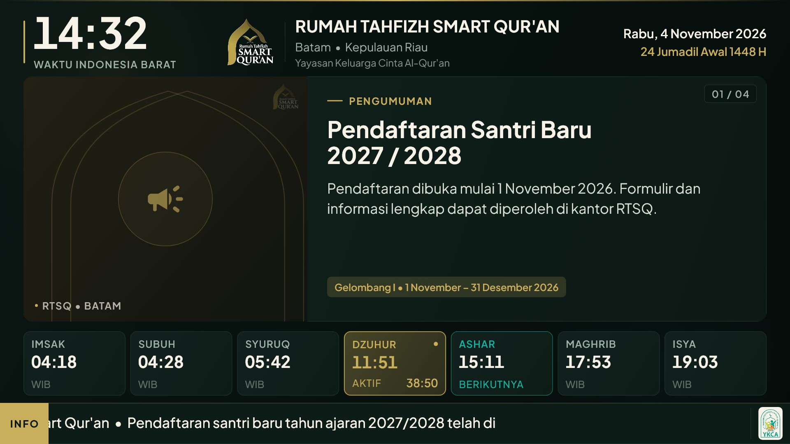
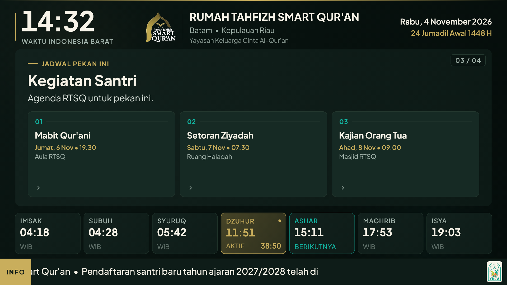

# Laporan Fase 0 — Fondasi & Prototipe Visual

Status: **Fase 0 selesai (visual), Fase 1 selesai (waktu & jadwal sholat)**,
menunggu uji perangkat TV nyata dan aplikasi TV terhubung ke Supabase (Fase 2a).

## 1. Yang sudah jadi

### Aplikasi TV (Flutter)

- Proyek `rtsq_tv` dengan target **Android TV, Web, Windows**.
- Kanvas tetap **1920×1080** yang diskalakan seragam (`FittedBox`), sehingga
  proporsi sama di TV 1080p, 720p, dan jendela desktop.
- Susunan layar (total 1080 px):
  - **Header 180 px** — jam besar WIB (104 px), logo RTSQ resmi, identitas
    lembaga (40 px), tanggal Masehi + Hijriah dinamis.
  - **Slideshow 616 px** — 4 tata letak: pengumuman, prestasi, jadwal, foto.
    Perpindahan otomatis tiap 10 detik, transisi fade 380 ms, indikator
    `01 / 04`.
  - **Strip sholat 184 px** — 7 kartu (Imsak, Subuh, Syuruq, Dzuhur, Ashar,
    Maghrib, Isya), kartu aktif emas, kartu berikutnya teal, hitung mundur
    ke sholat berikutnya.
  - **Ticker 100 px** — teks berjalan 60 px/detik, chip `INFO`, logo YKCA.
- **Safe area** mengikuti Blueprint §5.1: padding horizontal **57 px**
  (±3%) dan padding atas **32 px**.
- **Tipografi** mengikuti Blueprint §5.3: tidak ada teks di bawah **24 px**.
  Ukuran yang dipakai: 24, 28, 30, 32, 34, 40, 56, 58, 104 px.
- Tanggal **Hijriah dinamis** memakai paket `hijri` (Umm al-Qura), dengan
  pergantian hari saat Maghrib dan dukungan offset admin.
- Palet diturunkan dari logo resmi: emas `#C9AE5C`, teal `#12B3A0`, latar
  hijau gelap `#07110E`.
- Tipografi **Plus Jakarta Sans** (variabel) dan **Amiri** untuk Arab.
- Layar selalu menyala (`wakelock_plus`), orientasi landscape, mode imersif.
- Inisialisasi Supabase dibungkus `try/catch` + batas waktu **8 detik**, sehingga
  TV tetap menampilkan konten lokal bila jaringan/konfigurasi bermasalah.

### Android TV

- `applicationId` **`id.rtsq.tv`**, `minSdk 24`, `targetSdk 34`.
- Manifest mendukung **leanback launcher** dan **HOME** (calon kiosk).
- Banner TV 320×180 dan ikon launcher sudah dibuat dari logo resmi.
- Izin: internet, network state, wake lock, boot completed.

### Supabase

- 8 berkas migrasi siap tempel/`db push` di `supabase/migrations/`:
  ekstensi, enum, tabel + indeks + trigger, RPC, RLS, storage, realtime, seed.
- RPC: pairing perangkat, heartbeat, claim/complete command, undangan admin,
  aktivasi admin, pembersihan log.
- RLS: admin vs perangkat paired vs sesi anonim; perangkat hanya bisa membaca.
- Bucket privat `tv-media` + policy.
- Panduan ada di `supabase/README.md`; `supabase/apply_all.sql` siap tempel
  sekali. Jika paste terpotong, gunakan `supabase/chunks/01.sql`–`10.sql`
  (masing-masing < 175 baris). Migrasi 0002–0008 sudah diuji lokal dengan
  PGlite (termasuk trigger audit).
- **Sudah dijalankan** ke proyek `qrjamxhbfnemfinqbhfh` pada 5 November 2026:
  160 statement sukses; REST mengembalikan 200 untuk `settings`, `contents`,
  `ticker`, dan `devices`.

### Fase 1 — Waktu & Jadwal Sholat (selesai)

- `TimeService` UTC+7 + koreksi header `Date` dari `https://www.gstatic.com/generate_204`
  saat start dan tiap 6 jam, timeout 8 detik, fallback ke jam perangkat.
- `PrayerService`: myquran/Kemenag `0506` Kota Batam sebagai sumber utama,
  cache aset offline (`assets/prayer/2026.json`, 12 bulan), fallback `adhan`
  (Subuh 20°, Isya 18°, ihtiyati 2 menit).
- Verifikasi jadwal 3 bulan vs Kemenag: `docs/verifikasi-jadwal.md`.
- Engine jadwal: hitung mundur, highlight kartu aktif/berikutnya, label Jumat
  pada Dzuhur hari Jumat, pergantian tanggal Hijriah saat Maghrib.
- `iqamahMinutes()` dan `ihtiyatiMinutes()` per waktu (default 0 ihtiyati).
- Header menampilkan `Rabu, 4 November 2026 • 24 Jumadil Awal 1448 H` (Hijriah
  dinamis dari paket `hijri 3.0.1`, Umm al-Qura).
- Unit test: rollover tengah malam → Subuh, Jumat, Hijriah tanggal/Maghrib/offset,
  tipografi floor 24 px.

### Kualitas

- `flutter analyze` — **0 masalah**.
- `flutter test` — **9 tes lulus**:
  - 3 golden: tampilan utama 1920×1080, slide jadwal 1920×1080,
    tampilan diskalakan 1280×720.
  - 2 logika sholat aktif/berikutnya.
  - 3 logika Hijriah (tanggal, Maghrib, offset admin).
  - 1 penjaga tipografi: menolak `fontSize` < 24 px di `lib/`.
- Golden test deterministik: jam, slide, dan posisi ticker dipatok.
- Tidak ada overflow pada 1920×1080 maupun 1280×720.

## 2. Pratinjau





## 3. Cara menjalankan

```powershell
cd "C:\RTSQ TV\rtsq_tv"
flutter run -d chrome          # pratinjau cepat
flutter run -d windows         # jendela desktop
flutter build apk --release    # APK untuk TV
```

## 4. Yang masih menunggu

1. **Bootstrap admin pertama** — setelah panel web ada, daftarkan email admin,
   lalu jalankan SQL bootstrap di `supabase/README.md`. Anonymous Sign-ins sudah
   aktif.
2. **Fase 0.5 — Uji perangkat nyata** — dokumentasi dan skrip sudah ada
   (`docs/tv-aqua.md`, `tools/provision_tv.ps1`), emulator sudah lulus. Sisa:
   uji di TV AQUA asli lewat ADB jaringan.
3. **Fase 2a — Supabase sinkronisasi ke aplikasi TV** — ✅ auth anonim, pairing +
   QR, `device_heartbeat`, snapshot. Lihat `docs/Fase 2a - Laporan.md`. Sisa:
   halaman persetujuan pairing di panel admin (Fase 3) dan cache media (Fase 2b).
4. **DNS `tv.rtsq.id`** — konfirmasi akses DNS untuk Cloudflare Pages.

## 5. Catatan biaya

Seluruh tumpukan yang dipakai sekarang **0 biaya**:

- Supabase Free (database, auth, storage, realtime)
- Cloudflare Pages Free (panel admin + domain kustom)
- Flutter & paket open source
- Distribusi APK via ADB/GitHub, tanpa Play Store

Tidak ada layanan berbayar yang diaktifkan.
